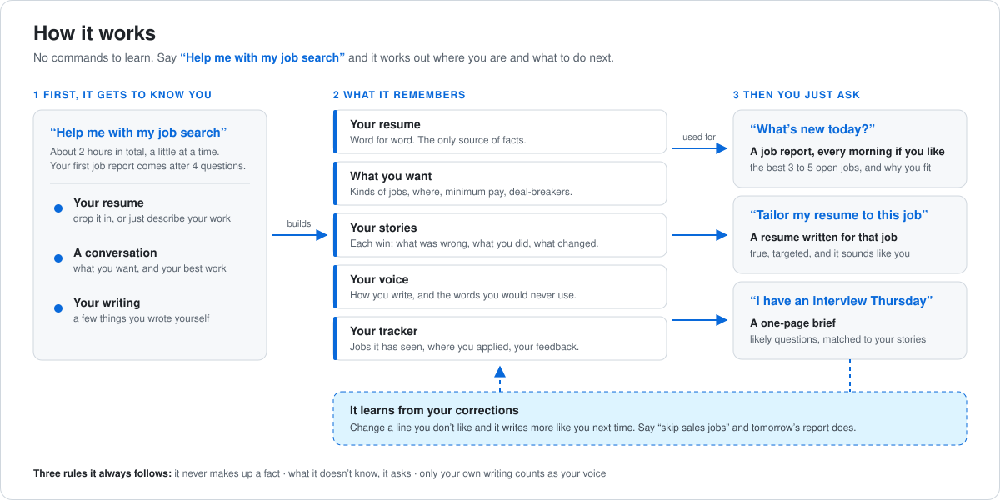

# Agentic Job Search Kit

Agent skills that run your job search every morning and write each resume in your own voice.

Most AI resume help fails in two ways: it sounds like AI, and it makes things up. These skills fix both by interviewing you first. You spend about two hours telling your agent what you did and how you write. After that it works only from facts you confirmed.

The skills are small and written in plain Markdown. Read them, change them, make them yours.



## Installation (2-minute setup)

A plugin is a managed bundle you subscribe to. [skills.sh](https://skills.sh) copies editable files into your project, and you update them by hand. Pick one per agent, because installing both gives you every skill twice.

### 1. Get the skills

<details>
<summary><strong>Claude Code</strong></summary>

```bash
claude plugin marketplace add tjj9020/agentic-job-search-kit
claude plugin install job-search-kit@tjj9020
```

To update, run `claude plugin marketplace update tjj9020`, or turn on auto-update for the marketplace under `/plugin` > Marketplaces.

</details>

<details>
<summary><strong>Codex</strong></summary>

```bash
codex plugin marketplace add tjj9020/agentic-job-search-kit
codex plugin add job-search-kit@tjj9020
```

Updates itself at startup.

</details>

<details>
<summary><strong>GitHub Copilot</strong> (CLI and VS Code)</summary>

```bash
copilot plugin marketplace add tjj9020/agentic-job-search-kit
copilot plugin install job-search-kit@tjj9020
```

In VS Code, run **Chat: Install Plugin From Source** and enter `https://github.com/tjj9020/agentic-job-search-kit`.

</details>

<details>
<summary><strong>Gemini CLI</strong> (manual updates)</summary>

```bash
gemini skills install https://github.com/tjj9020/agentic-job-search-kit.git --path skills
```

Re-run the command to update.

</details>

<details>
<summary><strong>Cursor, Windsurf, and any other agent</strong> (manual updates)</summary>

```bash
npx skills@latest add tjj9020/agentic-job-search-kit -a <agent>  # cursor, windsurf, opencode, amp; omit -a to choose
```

When the installer asks which skills to take, include `career-setup`. To update, run `npx skills@latest update`.

</details>

<details>
<summary><strong>Chat apps with no installer</strong> (ChatGPT, Grok, Claude on the web)</summary>

If your app has a place to upload skills, upload the four folders under [`skills/`](skills). If it does not, create a project, attach the four `SKILL.md` files to it, and say "follow career-setup". Keep everything in that one project so your documents carry over between chats.

</details>

### 2. Run `/career-setup`

Run it once. Have your current resume ready, plus three to five things you wrote yourself without AI help. It will:

- Save your resume as the source of facts, then ask about every claim it can't verify
- Interview you for what you want: roles, location, pay floor, culture, deal-breakers
- Build your **story bank**: each accomplishment as situation, behavior and impact, with proof
- Build your **voice profile**: how you write, the words you never use, and examples you approved

You can stop at any point and say "continue career setup" later.

### 3. You're ready

- "Run the job scout every morning at 7."
- "Tailor my resume to this posting: `<link>`"

## Why these skills exist

### #1: The resume sounds like AI

**The problem.** Ask an AI for a resume and you get "spearheaded" and "leveraged" in bullets that all have the same shape and length. Recruiters spot it in seconds. It could be anyone's resume, so it sells no one.

**The fix** is a voice profile. [`/career-setup`](skills/career-setup/SKILL.md) reads writing you did yourself, finds the rules you follow without noticing, shows you the same bullet written two ways and asks which one is you, and keeps a list of words you would never say out loud. Every later draft is checked against it. Samples written with AI are excluded, because the agent would learn the AI's habits and hand them back to you.

### #2: The AI makes things up

**The problem.** An agent asked to make you look good will round a number up, upgrade a title, or invent a metric to fill a gap. You find out in the interview.

**The fix** is a story bank and three rules built into every skill:

1. The AI never invents a fact.
2. A blank stays blank until you fill it.
3. Nothing AI-written counts as a sample of your voice.

Before a resume reaches you, every number in it is traced back to something you confirmed.

Where the story bank doesn't know something, it lists an open question instead of guessing.

### #3: Job boards are mostly noise

**The problem.** Half the listings an aggregator shows are expired, reposted, or the wrong level. Checking them by hand every day is a second job.

**The fix** is [`/job-scout`](skills/job-scout/SKILL.md). It searches, drops anything that fails your hard filters, confirms each posting is still live on the employer's own site, scores what is left out of 100, and researches only the best three to five. A ledger remembers every role it has seen, so you never read about the same one twice. If nothing is good enough, it says so instead of padding the report.

### #4: Every application starts from zero

**The problem.** A resume aimed at one posting takes an hour to do well, so most people send the same one everywhere.

**The fix** is [`/tailor-resume`](skills/tailor-resume/SKILL.md). It reads the posting, shows you which of your stories prove each requirement and where the gaps are, and waits for your go-ahead. Then it writes the resume. Edit any line and the voice profile learns from the edit, so the next draft needs less work.

## Reference

Every skill is model-invoked: type its name, or just ask for what you want and your agent reaches for it.

| Skill | What it does | When |
| --- | --- | --- |
| [`career-setup`](skills/career-setup/SKILL.md) | Saves your resume, interviews you for search criteria, builds your story bank and voice profile | Once, at the start |
| [`job-scout`](skills/job-scout/SKILL.md) | Searches, verifies, scores and researches roles, then sends one fit report | Daily, on a schedule or on demand |
| [`tailor-resume`](skills/tailor-resume/SKILL.md) | Maps a posting to your stories and writes a resume for it in your voice | Every time you apply |
| [`linkedin-pass`](skills/linkedin-pass/SKILL.md) | Brings your LinkedIn profile in line with your resume. You approve every change. | Optional |

The skills share five documents, kept in a `career/` folder or in your project's files:

| Document | Holds |
| --- | --- |
| `resume-base.md` | Your current resume, word for word. The source of facts. |
| `search-criteria.md` | Target roles, location, pay floor, culture criteria, deal-breakers |
| `resume-story-bank.md` | Each accomplishment as situation, behavior, impact, with proof and your own words |
| `resume-voice-profile.md` | How you write: rules, preferred and banned words, examples you approved |
| `job-scout-ledger.md` | Roles already evaluated, plus your feedback to steer the search |

## Keeping it sharp

- **Steer the scout.** Add a line under "Feedback from me" in the ledger ("skip agencies", "applied to X"). The next run obeys it.
- **Edit the lines you don't like.** After three or four tailored resumes, first drafts need little change.
- **Answer the open questions.** Every answer becomes a stronger bullet.
- **Add wins as they happen**, while the numbers are fresh.
- **Read every resume before it goes out.** You are the one signing it.

## License

MIT. See [LICENSE](LICENSE).
